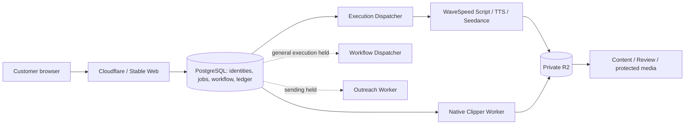

# AI Site progress audit against the original PDFs

Requested audit date: **3 November 2026**. Evidence was collected on 3 November and refreshed on **4 November 2026, Asia/Shanghai** after the interrupted session. The requested filenames are retained. This is an audit, not authorization to implement or activate anything.

Closing database snapshot: **November 4, 11:51:35 Asia/Shanghai (03:51:35 UTC)**. Closing public HTTPS verification finished at **11:52:43 Asia/Shanghai**. Individual evidence files retain their own observation times.

**Verdict: substantially implemented, but not ready for a new paying customer or public commercial launch.** The engineering coverage estimate is **73.4%**. First-paid-release acceptance readiness is **49.7%** and public launch readiness is **41.6%** under the requirement-based method below. These are different measures. There is no completed fresh-customer acceptance certificate.

## 1. Scope, sources and verification boundary

The authoritative sources are the September 28, 2026 requirements:

- [Employee Implementation Guide](<C:/Users/lbbch/Downloads/WhatsApp Unknown 2026-09-29 at 10.40.46/Employee_Implementation_Guide_EN_v2.pdf>), all eight pages, including Stages 0-6 and the seven-step owner script on page 8.
- [Page-by-Page Explanation](<C:/Users/lbbch/Downloads/WhatsApp Unknown 2026-09-29 at 10.40.46/Page_by_Page_Explanation.pdf>), all eight pages.
- [17-screen walkthrough](<C:/Users/lbbch/Downloads/WhatsApp Unknown 2026-09-29 at 10.40.46/UI_Walkthrough_17_Pages.pdf>), all 17 image pages, rendered for inspection. Its prices, balances, brands and sales figures are examples.
- [October 23 audit](C:/Data/ai-site-audit-2026-10-23/AI-Site-Final-SaaS-Audit.md), used as historical comparison rather than present-day proof.

The [requirements matrix](C:/Data/ai-site-audit-2026-11-03/ORIGINAL_PDF_REQUIREMENTS_MATRIX.csv) contains **128 checks**: 115 across Stages 0-6 and 13 cross-cutting launch, recovery and customer-acceptance checks. Every row has exactly one requested status, a requirement source, implementation, evidence path, missing behavior, severity, completion action and roadmap reference. The cross-cutting checks include the guide's launch conditions and the requested commercial scope. Related clauses are grouped where they share one acceptance test; fields within an explicitly grouped clause are named in the row.

The Job-field check evaluates the required information across the normalized model: provider details in `provider_executions`, quoted/reserved/captured/released amounts in `job_billing` and the ledger, and outputs in `job_artifacts`/the sealed result. It does not claim that every guide field is a same-named physical column on `jobs`; there is no literal `output_asset_id` column. Those normalized relationships preserve the required traceability without duplicating the financial source of truth.

Status rules:

| Status | Meaning in this audit |
| --- | --- |
| PASS | A bounded requirement is verified on the current deployed source/data or retained same-build real execution. A bounded component PASS does not certify its entire page or journey. |
| PARTIAL | Implementation exists, but the complete requirement or current customer acceptance is incomplete. |
| DISABLED | Implementation exists and is intentionally unavailable through release controls. |
| FAIL | The required behavior is absent, demonstrably broken, or differs from the literal requirement. |
| UNVERIFIED | The evidence does not establish the required acceptance result. |

Current verification included immutable release/Worker hashes; PostgreSQL reads with `default_transaction_read_only=on` and READ ONLY transactions; direct reads through deployed application functions using existing session metadata; public/loopback HTTP GETs; private R2 HEAD/GET reads; and retained real execution receipts. The application-function checks did **not** create a session or impersonate a browser login. They establish data retrieval and selected server permission behavior, not authenticated HTTP/browser acceptance.

No application fixes, deployments, restarts, migrations, account creation, feature activation, quotes, jobs, payments, ledger entries, review decisions, email or Outreach messages were created. No paid AI endpoint was called. Writes were confined to this separate audit folder. Media checks read existing objects; the audit did not regenerate them.

**UI limitation:** the in-app browser bridge timed out. All reference screens were inspected, current deployed UI source was reviewed, and historical real screenshots were inspected. No new signed-in desktop/mobile screenshot or form/action acceptance was obtained during this audit. Historical screenshots and fixture results are labelled as such. Saving forms, approving output, and exercising checkout would also violate the instruction against changing application records. Their outstanding acceptance is recorded rather than assumed. See [screen parity audit](C:/Data/ai-site-audit-2026-11-03/17_SCREEN_PARITY_AUDIT.md).

## 2. Actual running system

Public Stable: [ai-test.proyaofficial.com](https://ai-test.proyaofficial.com).

| Component | Verified identity/state |
| --- | --- |
| Web | `530e81b21bf6b9f1797cba57dcb2dd4d2402b831`, build `DW_qT5DJOl3qpjSs-WD8c`; managed process PID 29024 observed on November 3. The same scheduled plan remained Running on November 4. |
| Execution Dispatcher | Matching revision/build; PID 33424 observed; current service heartbeat RUNNING. |
| Native Worker | Matching managed revision `530e81b...`; 468 pinned Worker files match; registration `31cc1007-058a-4d6f-aaf9-01fca38d90ae` ACTIVE, one slot, fresh heartbeat on November 4. |
| Workflow Dispatcher | STOPPED/HELD_DISABLED after the scoped pilot; no general execution process. |
| Outreach Worker | HELD_DISABLED; real sending and customer-channel data absent. |
| Database | Actual Stable PostgreSQL database is named `saas_dev`. This name does not make it an isolated development database. 34 migration journal entries are installed; migration 0032 is deliberately excluded. |
| Storage | Current configured backend is private R2. The October 24 cutover retired the SeaweedFS/gateway dependency; it did not recover historical missing media. |
| Stable checkout | `C:/Data/ai-site`, HEAD `8de4ab16476b87cb81eb642fd87899e42bd94cd0`. This checkout HEAD is **not** the running release. Existing changes were preserved. |
| Development/reference work | `C:/Data/ai-site-dev` and `C:/Users/lbbch/.codex/worktrees/stage4-workflows/ai-site` contain development and isolated-stage evidence. They are not substitutes for Stable acceptance. |

The deployed application root is:

`C:/Data/ai-site/saas/data/test1-workflow-stable-20261102/pilot-848267e3/clipper-completion-20261103/releases/release-530e81b21bf6`

[Release integrity](C:/Data/ai-site-audit-2026-11-03/evidence/release-integrity.json) verified **2,453 release files and 468 Worker files with zero mismatches**, plus the actual `.next/BUILD_ID`. Managed environment files matched their pinned hashes. This is stronger revision evidence than reading either editable checkout's Git HEAD.

Runtime path:

Public GET verification ultimately returned root **307 to /login**, login **200**, and health **200**, consistent with loopback. Initial PowerShell/web-tool access failed with 530/inaccessibility; a subsequent direct Node HTTPS check succeeded. A sustained public outage is **not** established by that initial tool result. Anonymous 404s on Workflow/Review/Distribution/Analytics are consistent with the scoped preview guard, not proof those routes are absent.

Evidence: [closing database/configuration](C:/Data/ai-site-audit-2026-11-03/evidence/final-current.json), [closing public HTTPS and matching asset](C:/Data/ai-site-audit-2026-11-03/evidence/http-current.json), [initial HTTP reads](C:/Data/ai-site-audit-2026-11-03/evidence/http-readonly.json), [deployed application reads](C:/Data/ai-site-audit-2026-11-03/evidence/application-readonly.json), [scheduled tasks](C:/Data/ai-site-audit-2026-11-03/evidence/scheduled-tasks.json). The public login stylesheet matched the running release's local bytes/SHA-256, providing an additional check that the public site serves this deployed build.

## 3. Verification of the reported pilot milestone

The technical milestone is real. Its acceptance scope is narrower than a completed customer Workflow.

| Reported statement | Audit result |
| --- | --- |
| Real Script -> MiniMax TTS -> Seedance -> Native Clipper -> Library | **Verified technical outputs and lineage.** One successful Script, one TTS, one Video and one successful official Clipper successor are persisted. |
| Total 3,475 Tokens captured | **Verified:** 5 + 70 + 2,800 + 600. Each successful child captured once. |
| Wallet 5,385 Tokens | **Verified current:** 5,385 available / 0 reserved. |
| All 14 ledger checks passed | **Verified current:** every query returns zero violations. Checks involving payments are vacuous because Stable has zero payments; this is not checkout certification. |
| Original media and official MP4 verified | **Verified again on November 4:** authenticated reads of the current assembled source and official clip match database size/SHA-256. Same-build full decode and browser playback receipts also exist. |
| Pilot PREPARED/CLOSED | **Verified:** hash-pinned PREPARED manifest has no approval; it is expired and execution is closed. General Workflow/generation flags remain 0. |
| General Workflows and batch launch gated | **Verified:** one special pilot does not admit other users, runs or general batch starts. |
| Sandbox checkout/signup disabled | **Verified:** payments/test billing/signup/package visibility off; no active package pointers; no sandbox credentials in Stable. |
| Creative approval pending | **Verified:** both media items are PENDING_REVIEW; Content review decisions are zero. The Script has one APPROVE decision. |

Real child history:

| Operation | Job suffix | Outcome | Tokens |
| --- | --- | --- | ---: |
| Script | `83a77639...` | SUCCEEDED, one provider submit | 5 captured |
| MiniMax TTS | `1c91cc1a...` | SUCCEEDED, one provider submit | 70 captured |
| Seedance Video | `fa3e4dce...` | SUCCEEDED, one submit | 2,800 captured |
| Original Clipper attempt | `20ae7cb4...` | FAILED: `ANALYZER_INVALID_CANDIDATES` | 600 released; zero captured |
| Official Native successor | `80364da0...` | SUCCEEDED, one attempt | 600 captured |

The successful successor used **`EXPLICIT_SINGLE_CLIP_V1`**: an explicitly bounded selection using preserved transcript/timing, one render, and **zero new analyzer or transcription calls**. It proves actual Native rendering, publication, current stored bytes, failure release and successor settlement. It does not show that the original automatic analyzer selected a valid clip or that automatic paid retry/recovery is generally accepted. The correction retained the failed attempt rather than silently overwriting it.

The run `848267e3-8b03-456f-be81-e70943908483` is currently **PAUSED**, not SUCCEEDED. Its video-review gate and final clip-review gate are WAITING; COMPLETE is PENDING. The Clipper generation step succeeded at execution revision 2. The bounded technical continuation was explicitly allowed before creative approval; it is not evidence that the normal human-review requirement has been satisfied.

Current media proof:

| Existing object | Bytes | SHA-256 |
| --- | ---: | --- |
| Assembled original Video / source | 12,046,623 | `c734e1ea1937b50e869c2715fc9bdfbd87f970d6dd12bdb39ecc91a73eecbf8f` |
| Official 10-second, 720x1280 MP4 | 843,276 | `afc660809921c9979631e01df548c947aa72eaeae201020855e6a24536a0adee` |

The clip's production-lineage row explicitly points to the original Video's Content/version and the same Script/audio versions. The actual current Library search finds the official clip by Job ID and both media items by Workflow ID. An approved-reviewer link cannot exist yet because the media have not been approved.

Evidence: [current media integrity](C:/Data/ai-site-audit-2026-11-03/evidence/current-media-integrity.json), [closing jobs/ledger](C:/Data/ai-site-audit-2026-11-03/evidence/final-current.json), [lineage and larger Native job checks](C:/Data/ai-site-audit-2026-11-03/evidence/extra-current.json), and the retained [final pilot report](C:/Data/ai-site/saas/data/test1-workflow-stable-20261102/pilot-848267e3/clipper-completion-20261103/review/pilot-848267e3-COMPLETE/06-report/FINAL_REPORT.md).

## 4. Requirements and scoring

### 4.1 Method

The CSV is the calculation source, not an illustration of an independently chosen percentage. Each row earns four equally weighted engineering milestones:

1. Required code/configuration/documented mechanism exists.
2. It is deployed, or a documentation requirement is consistent with the current system.
3. Integrated behavior has evidence. This milestone may use historical isolated integration, clearly identified in the evidence column. A unit/fixture test does not earn original acceptance.
4. The row's bounded original acceptance is verified on current deployed evidence. Only PASS rows earn this milestone.

`Implementation_credit = (Code_present + Deployed_or_current + Integrated_behavior_evidence + Original_acceptance_verified) / 4`.

For acceptance readiness, PASS earns 1, PARTIAL earns 0.5, and DISABLED/FAIL/UNVERIFIED earn 0. This deliberately gives no acceptance credit for a fully coded but closed launch gate. Partial credit represents outstanding acceptance work, not a successful customer journey or permission to open access.

Requirements within each stage have equal weight. Stages have the following explicit weights; this prevents a stage receiving more weight merely because its clauses were split into more rows:

| Group | Checks | Original implementation weight | Engineering coverage | Acceptance index |
| --- | ---: | ---: | ---: | ---: |
| Stage 0, inventory/audit | 8 | 5% | 84.4% | 62.5% |
| Stage 1, identities/Products | 26 | 18% | 72.1% | 46.2% |
| Stage 2, creation/jobs/Library | 21 | 18% | 78.6% | 59.5% |
| Stage 3, Tokens/payments | 22 | 14% | 72.7% | 50.0% |
| Stage 4, Workflows | 15 | 18% | 78.3% | 36.7% |
| Stage 5, batch/review | 10 | 9% | 72.5% | 30.0% |
| Stage 6, Distribution/Analytics | 13 | 8% | 71.2% | 26.9% |
| Cross-cutting launch/recovery | 13 | 10% | 55.8% | 30.8% |

The first-paid-release score selects CSV rows marked `First_paid_core=1`. Within those rows, Stages 1/2/3/4/5 receive **20/25/20/25/10%** respectively. Public readiness uses **70%** of the full Stages 1-5 acceptance indices with those same proportions, plus **30%** of the cross-cutting launch/recovery index. Distribution implementation is the equal-weight average of its nine core send/channel/recipient/event checks, separate from operational Analytics.

Reproduce each headline by summing the relevant CSV weight times the relevant credit. All four weight columns sum to 1. Percentages are evidence indices, not probabilities, remaining calendar time, or a replacement for P0 gates. The 0.5 partial-credit and equal-milestone choices are transparent audit conventions; they are not objectively measured fractions of code or person-days.

### 4.2 Results

| Requested measure | Estimate | What it means |
| --- | ---: | --- |
| Overall original-PDF implementation | **73.4%, about 73%** | Most foundations and the new workflow/review layers exist. Known absent settings, commercial/recovery work and unaccepted behavior remain. |
| First-paid-release acceptance readiness | **49.7%, about 50%** | The core is substantially built, but a fresh customer cannot enter/fund/execute/approve the complete journey. |
| Public commercial launch readiness | **41.6%, about 42%** | Requires the core acceptance plus onboarding, merchant readiness, recovery, policies and commercial-domain work. |
| Optional Distribution/Outreach implementation | **63.9%, about 64%** | A large queue/recipient/safety/UI implementation exists, primarily accepted with TEST adapters. It lacks a certified real customer channel. |

Optional Distribution's acceptance-evidence index is **5.6%**; **zero current customer channels or genuine customer send batches are certified**. Do not describe the implementation score as live sending completeness.

There are **25 PASS, 63 PARTIAL, 24 DISABLED, 9 FAIL and 7 UNVERIFIED** rows. PASS rows represent **19.2% of the weighted original/cross-cutting requirements**. The engineering estimate is higher because completed construction/deployment milestones still count when customer acceptance is incomplete. This explicitly prevents 73% engineering coverage being presented as 73% of customer workflows verified.

The prior audit did not use this matrix/weighting. A numerical percentage-point improvement from October 23 would be unjustified without reconstructing equivalent evidence. The comparison below reports concrete behavior changes instead.

## 5. The seven-step final owner script

| Original owner step | Current status | Evidence and remaining acceptance |
| --- | --- | --- |
| 1. Register Brand A; upload serum front/back, pump close-up and authentic usage footage; save rules | **DISABLED** | Public registration is 404. Existing Product mechanisms persist, but the real pilot Product had one front PNG, not the required new-account reference/footage pack. |
| 2. Start UGC Workflow: 2 Scripts, 2 Videos each, 2 Clips each; inspect quote | **DISABLED** | Full controlled graph exists and passed historical isolated fixtures. The Stable exception permits one fixed 1x1x1 DEMO pilot, not a new UGC customer graph. |
| 3. Insufficient funds; sandbox pay; submit once; one run | **DISABLED** | Sandbox checkout/packages/test billing are closed; sandbox and PRODUCTION realm policies conflict if merely toggled. Stable has zero payments. Existing idempotency code and earlier tests do not complete this step. |
| 4. Close browser; return; inspect progress/reservation and provider failure/release | **PARTIAL** | Real background records and a 600-Token failure release exist. The original multi-output recovery scenario and safe ordinary resume remain unaccepted. |
| 5. Reject incorrect packaging; approve others; rejected branch stops | **PARTIAL** | Current review data retrieval works and isolated approval/rejection/regeneration gates passed. Stable Content decisions are zero; special technical continuation is not creative approval. |
| 6. Download approved clip; trace references, Script, Jobs, reviewer and ledger | **PARTIAL** | Current original/clip bytes and production lineage verify. Same-build playback reached 10/10 seconds. The media remain pending, so approved-version/reviewer acceptance is missing. |
| 7. Brand B tries Brand A pages/object/media URLs; all denied | **PARTIAL** | Current server reads deny an unrelated membership with 404 and a Viewer spend permission with 403. Historical HTTP/media isolation receipts exist. A fresh full authenticated A/B HTTP/media test on the customer candidate remains required. |

**The seven-step script has not passed.** Isolated 2x2x2 and 20-item results are implementation evidence, not evidence that a normal paying customer can use those workflows today.

At today's retained prices, an illustrative 20-second 2x2x2 plan with TTS would be **2x5 + 2x70 + 4x2,800 + 4x700 = 14,150 Tokens**, before explicitly quoted replacements. It has **12 base Jobs**, including two TTS Jobs, and eight clip outputs. The current wallet is 8,765 Tokens short of that base illustration. No new quote, top-up or run was issued. A future full quote must be authoritative, and its budget must include separately approved failure/replacement work.

## 6. Commercial readiness

### Payments, catalog and wallet

**Sandbox:** a genuine hosted Xendit Sandbox purchase and duplicate-confirmation acceptance exist historically in isolated Development. Stable has `XENDIT_MODE=sandbox`, `PAYMENTS_ENABLED=0`, `ENABLE_TEST_BILLING=0`, package visibility off, and no test key, callback token, business ID or return-origin setting. Its adapter restricts sandbox to a TEST billing realm and permitted test origins; Stable PRODUCTION accounting cannot safely be made sandbox by adding four credentials or flipping one flag. Use the already isolated candidate path, or a separately reviewed scoped policy that cannot credit simulated money into ordinary production funds.

**Production:** Live payment gates are 0 and Live secret/callback/business fields are absent. A return origin alone does not establish merchant/channel approval. Actual production checkout, confirmation, idempotency, pending/unknown recovery and refund support have not passed. A sandbox success is insufficient for a genuinely paid beta.

| Staged package | Tokens | Whole IDR price | Current active pointer |
| --- | ---: | ---: | --- |
| Starter | 1,000 | 75,000 | NULL |
| Creator | 5,000 | 350,000 | NULL |
| Pro | 10,000 | 650,000 | NULL |

Active operation pricing remains QUALITY Video 140 Tokens/second, Clipper 400 base + 100/requested clip + 100/captions, visual variation 100/render under internal-beta policy, and Outreach 10/successful confirmed send under internal-beta policy. The two reviewed Script/TTS definitions charge 5/70 only inside the sealed pilot; their **global active pointers remain NULL**. Existing beta labels and Native short-output/full-quote behavior need explicit customer agreement before broad sales.

The account-wallet design is an explicit divergence from the PDF's Workspace wallet: three billing accounts span multiple Workspaces, up to four each. Current checks found no cross-Workspace Product/Content mismatch, and shared-account behavior is not itself proof of a tenant leak. The owner must accept this product/accounting boundary or fund a proper per-Workspace change. This audit does not silently waive the requirement.

The fiat refund helper is concretely blocked: `refundPayment` requests `/refunds`, while `xenditRequest` permits only POST `/sessions` or GET of one `ps-...` session. A documented merchant-dashboard/manual support path can be the smallest beta solution; advertising a working automated refund feature would be incorrect.

### Costs and margins

The retained actual invoice receipts total **US$6.4902**:

- Script: $0.001.
- TTS: $0.0088.
- Video: $6.48.
- Failed original Clipper analysis: $0.0004, with zero customer capture for that failed Job.
- Official deterministic Clipper successor: $0 in additional AI provider requests; local compute/storage still have costs.

These are retained actual receipt amounts, including provider rounding, not a fresh November 4 provider-rate or balance certification. No new provider invoice/balance call was made. Provider `usage_metadata` is empty in all ten current execution rows; costs and margins are not automatically populated in the customer platform. The operator-only report truthfully shows unavailable actual-cost/FX/margin data.

The current wallet came from promotional funding, not a paid purchase; Stable has no realized customer purchase revenue. Applying inactive package values to 3,475 consumed Tokens gives **225,875-260,625 IDR of hypothetical package value**, not realized sales. A legitimate margin requires an approved FX basis, merchant fees/taxes, compute/storage/egress, retry/failure exposure and refund policy. Do not turn the $6.4902 receipt into a claimed margin percentage.

### Recovery and operations

Current positive evidence: matching managed processes, fresh Worker/Dispatcher heartbeats, a recent protected database dump that was restored and checked across 111 business tables, and retained startup/rollback dry runs. These materially improve the October 23 situation.

Current gap: **`AI Site Daily Encrypted Backup` is Disabled**, intentionally following the October 24 R2 cutover. Its last successful automatic run was October 24 at 02:00 Asia/Shanghai. Registered `backup_records` contain only two October 23 UTC dumps through migration 0020, with no registered restore timestamps. Recent deployment-specific restore proof is outside those rows. A valid recent dump does not make the recurring programme current or provide an independent backup of new R2 media.

R2 remains the sole demonstrated permanent customer-media store, with no current independent restorable media copy established. The cutover report documented an unrestricted shared-credential exception; current IAM scope was not independently certified by this audit. Original imported Native rights restrictions remain test1-only.

Fresh November 4 HEAD checks reconfirmed **all 125 historical missing objects are still absent**, with a positive control successfully reading the official new clip and zero request errors: 38 Product originals, 36 thumbnails, 35 Job artifacts, 14 posters and two sources. Their exception-registry SHA-256 remains `951d270f70a2461e53856e268b394278ce9f12a23779cede7c031f1e87a12edd`. This does not imply loss of the newly verified pilot media. No new exhaustive bucket-integrity scan or recovery attempt was performed. See [current missing-object verification](C:/Data/ai-site-audit-2026-11-03/evidence/current-storage-heads.json).

Web/Dispatcher/Worker login tasks are now Running with restart retry settings, unlike the prior never-run task evidence. A real current host/Docker reboot recovery, automatic backup catch-up and alert-delivery drill remain unverified. The shortest route is to finish the existing tools, not introduce another hosting or storage platform.

### Customer launch operations

Signup and verification mechanisms exist but are closed to new public accounts. Current SMTP credentials/configuration exist; fresh external delivery/reset/onboarding acceptance was not performed. No invitation exists in Stable, and Settings still tells a successful inviter to find a link in a local development mailbox.

Operator investigation, billing reconciliation, logs and support CLI tools exist. Assigned support ownership, refund procedures, commercial policies, retention/deletion behavior and independent commercial brand/domain sign-off remain outstanding or unverified. Current metadata still calls the product a customer preview and uses `noindex`.

## 7. Progress since October 23

| October 23 blocker/finding | Present evidence | Disposition |
| --- | --- | --- |
| Native batches above 12 artifacts could succeed without settlement | Shared completion/publication/settlement manifest is deployed. Current real paid Native jobs have 20 and 62 artifacts, with 18/60 clips and CAPTURED billing. | **Resolved for the demonstrated settlement defect.** Broader malformed/replay/max-count acceptance remains in regression coverage. |
| No AI Script Job, no exact narration path, no integrated full content template | Persistent Script/TTS and full controlled production template are deployed; actual Script/TTS/Video and official clip now exist. | **Major implementation blocker resolved; complete customer acceptance remains partial.** |
| Workflow form could not express 2x2x2 | Full plan/count/budget form and controlled tree passed isolated integration. | **Implemented; general execution still disabled.** |
| Review regeneration/version linkage missing | Stage 5 implemented exact-version decisions, quotes, regeneration/retry receipts and retained prior versions. | **Implemented; new paid regeneration and real production review acceptance remain closed/missing.** |
| No 20-item customer batch layer | Bounded batch quotes/run shares/results passed 20-item fixture acceptance. Current Stable batch tables remain empty. | **Implemented; customer batch availability and real acceptance remain outstanding.** |
| `/analytics` absent | Deployed report computes 77 real-record metrics and current pilot totals; UI is restricted by preview policy. | **Absence resolved.** General access and final customer reconciliation are incomplete. |
| Library search did not match Job/Workflow IDs | Current deployed functions return the official clip by Job ID and both outputs by Workflow ID. | **Resolved for verified search cases.** |
| Local storage durability and stale backup programme | R2 cutover completed. Automatic combined backup was subsequently intentionally disabled. Recent deployment database restore proof exists. | **Storage migration resolved; unattended current DB/media recovery remains a launch blocker.** |
| Historical 125 media losses | Fresh HEAD checks still find exactly those 125 objects absent. | **Unresolved.** No recovery inferred from an exception registry. |
| Signup/packages/purchasing/Live closed | Flags remain closed, package pointers NULL, Stable payments zero. | **Unresolved.** Sandbox remains a separate prerequisite. |
| Workspace-wallet semantics differ from PDF | Account wallets still share funds across Workspaces. | **Unresolved product/accounting decision.** |
| No actual provider cost/margin in the app | Real pilot cost receipts now exist, but provider usage metadata and realized revenue/margin remain unavailable. | **Improved evidence; automated costing and policy unresolved.** |
| Tenant roles and current full customer path not accepted | Added isolated role/media evidence and same-build pilot media receipts; current read negatives pass. | **Improved, not a fresh complete customer acceptance.** |

Newly relevant problems/limits:

1. The real automatic Clipper branch failed candidate validation; the official correction used a special deterministic mode. Do not certify general automatic recovery from that result.
2. The headline technical pilot is still PAUSED with two waiting media reviews. It cannot be advertised as an owner-approved finished Workflow.
3. Script/TTS now appear in billing usage, but the component routes every non-Video operation to `/clipper/:id`. The deployed Clipper read for the real Script Job returns 404. Use the generic Job route or type-aware destinations.
4. The intentionally disabled backup task now protects a substantially newer schema and growing R2 output set only through ad hoc deployment procedures. Its old registered backup rows do not certify current unattended recovery.
5. The same-build preview now contains substantial implemented pages that normal customers cannot access. Their deliberate 404/closed actions must not be counted as available customer features.

## 8. What is missing and the shortest completion route

The important remaining first-paid blockers are **customer admission; a usable, correctly separated sandbox path; genuine production checkout for a paid beta; active reviewed catalog/packages; complete 2x2x2 owner acceptance with real references/footage; approve/reject/regenerate and funds/recovery acceptance; exact-candidate tenant/media/role proof; recurring current database and independent media recovery; and commercial identity/terms/support/economics decisions.**

Missing original parity beyond that beta includes customer retention/deletion settings and explanation, notification controls, statement export, the draft-SKU uniqueness rule, complete general batch acceptance, and some Home/Settings/navigation behavior. Additional quality-tier/standalone-quantity breadth can remain a clearly stated product limitation while the beta runs. Live creator Outreach, replies/posts and attributed commerce are explicitly later-stage work under guide pages 1 and 6.

See [remaining-work roadmap](C:/Data/ai-site-audit-2026-11-03/REMAINING_WORK_ROADMAP.md) for every task, dependencies, accounts/credentials, paid-test need and acceptance exit.

Recommended order: decide the beta admission/account-wallet/pricing boundaries; repair only the bounded admission/payment/UX gaps; verify the existing recovery tools; then perform one combined customer/tenant/payment/production acceptance window. Do not build another engine or create separate infrastructure phases for each individual check.

## 9. Direct answers

| Question | Answer |
| --- | --- |
| How much of the original project is complete? | About **73% of implementation milestones** by the matrix; **50% first-paid acceptance readiness**. The complete owner journey has not passed. |
| Which original requirements remain missing? | General customer Workflow/batch access, actual original-scale owner acceptance, customer payment/active packages, completed media review/regeneration acceptance, strict Workspace-wallet semantics or explicit deviation, retention/deletion, notifications, statement export, draft-SKU uniqueness, unattended recovery, and later real customer Distribution/commerce integrations. Some are built but disabled rather than absent. |
| What prevents a normal new customer using it today? | Signup is closed; purchasing/packages are closed; no Sandbox/Live checkout is accepted in Stable; new workflow pages/execution are scoped to test1; Script/TTS global prices are inactive; media review and recovery/launch conditions remain incomplete. |
| Minimum work for a genuinely paid beta? | Complete B1-B9 in the roadmap: **12-22 developer workdays**, using the existing stack and one bounded acceptance programme. A sandbox-funded or grant-funded pilot alone is not a paid beta. |
| Additional work for full public launch? | Public onboarding/phone acceptance, remaining customer parity/policy settings and stronger routine operations/capacity/cost/support acceptance: **10-16 additional developer workdays**, assuming beta gates pass and the accepted scope is unchanged. |
| How many days remain, with uncertainty? | Paid beta **12-22**; public launch **22-38 total from now**. Strict separate Workspace wallets add approximately **3-6** if the shared-account deviation is rejected. Optional real-channel Distribution adds **12-25**, separately. Merchant/domain/legal/channel approval elapsed time is excluded and may dominate the calendar. These are planning ranges, not measured completion dates. |
| What should be built next? | The smallest scoped release that admits a brand-new approved customer through the existing Product -> Workflow -> quote -> payment -> review/download path, together with current automatic recovery. Repair the confirmed Script/TTS billing links. Validate the full original acceptance before expanding batches or Outreach. |

No recommended change has been implemented by this audit. The [closing preservation check](C:/Data/ai-site-audit-2026-11-03/evidence/audit-preservation.json) found no change across 29 fingerprinted business tables between the November 3 and November 4 snapshots. Counts remain 65 Jobs, 10 provider executions, zero payments, 93 ledger entries, 198 quotes, 135 sessions, zero Content review decisions, zero production batches and one Workflow run. Natural service heartbeats are outside that business-fingerprint set. All current queries succeeded and the actual Worker environment also matched its pinned hash.

## 10. Evidence index

Current audit evidence is in [the evidence folder](C:/Data/ai-site-audit-2026-11-03/evidence). Principal files:

- `final-current.json`: closing explicit read-only database identity, schema/counts, safe configuration/preview flags, actual Worker environment hash, quote/catalog/payment/Job/review state and all 14 reconciliation queries. `refresh-20261104.json` retains the earlier November 4 snapshot.
- `application-readonly.json`: current deployed Product/Library/search/Workflow/Review/Analytics/Billing reads, current foreign/Viewer denials and the Script-to-Clipper 404 reproduction. Expected denial checks are recorded as exceptions and interpreted as successful negative controls.
- `extra-current.json`: actual larger Native paid jobs, pilot quote versions, exact Script/audio/parent Content lineage and the ACTIVE-only SKU index. Its optional media-observation query failed on an incorrect audit column name; that query was not used as evidence of application failure or media availability. Fresh storage HEAD checks supply that evidence.
- `release-integrity.json`: 2,453 application files and 468 Worker files checked against their release/plan pins.
- `http-readonly.json`, `http-current.json`: initial public/loopback and closing public reachability/gate checks, including the matching public stylesheet; authenticated functionality is not inferred from them.
- `current-storage-heads.json`: current 125 missing-object checks and successful official-clip positive control.
- `current-media-integrity.json`: fresh actual R2 bytes/hash verification of the source Video and official clip.
- `scheduled-tasks.json`: current task states, last runs and settings; backup status is explicitly Disabled.
- `audit-data.json`, `score-calculation.json`: row-level milestone credits and reproducible weight calculations behind the CSV/headline estimates.
- `audit-preservation.json`, `source-provenance.json`, `deliverable-validation.json`: closing business preservation, exact source PDF hashes/page counts, and artifact/link/calculation checks.
- `pdf-reference/`: all 17 rendered reference pages and labelled contact sheets. `historical-ui-contact.jpg` is explicitly historical fixture UI, not November 4 visual acceptance.

Historical implementation evidence remains at [Stage 4 Script/audio report](C:/Users/lbbch/.codex/worktrees/stage4-workflows/ai-site/STAGE4_SCRIPTS_AUDIO_REPORT.md), [Stage 5 review/batch report](C:/Users/lbbch/.codex/worktrees/stage4-workflows/ai-site/STAGE5_REVIEW_BATCH_REPORT.md), [Stage 6 Distribution report](C:/Users/lbbch/.codex/worktrees/stage4-workflows/ai-site/STAGE6_DISTRIBUTION_REPORT.md), [Analytics report](C:/Users/lbbch/.codex/worktrees/stage4-workflows/ai-site/STAGE6_ANALYTICS_REPORT.md), [R2 cutover](C:/Data/ai-site-dev/R2_PRODUCTION_CUTOVER_REPORT.md), [authentication/recovery checks](C:/Data/ai-site-dev/CUSTOMER_ACCESS_RECOVERY_CHECKS.md), and [genuine Sandbox integration](C:/Data/ai-site-dev/XENDIT_SANDBOX.md). The CSV resolves each requirement to exact current source file paths, source lines where anchored, and relevant evidence files.
